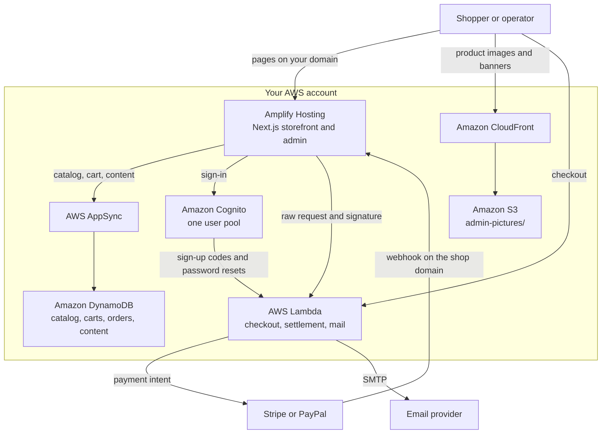

# Architecture

FatLeon commerce software is one Next.js application. Shoppers and operators use the same deployment. The storefront is `/{locale}`. The admin is `/{locale}/admin`. Amplify Hosting runs that application. The backend is Amplify Gen 2 in the same repository, in your AWS account.

This page describes that shape: which service does what, how a visit and an order move, and what you still operate. The same description is on the [architecture reference](https://docs.fatleon.com/reference/architecture). What the product includes is on the [feature list](features.md).

The [local sandbox](https://docs.fatleon.com/local-development/local-sandbox) uses this same shape. It is a separate stack in your AWS account, not a second design.

The store runs in your AWS account. Stripe, PayPal, and the email provider stay outside it. A visit reads the catalog through AppSync. Checkout calls Lambda directly. Payment webhooks return to the shop domain, and the Next.js app forwards them to Lambda.

## Services

| Piece | Role |
|---|---|
| Amplify Hosting | The Next.js application: storefront and admin |
| Amazon Cognito | One user pool. Email sign-up. The Users, Admins, and Affiliates groups |
| AWS AppSync and Amazon DynamoDB | Catalog, carts, orders, and content |
| AWS Lambda | Checkout, payment settlement, returns, admin writes, and outbound mail |
| Amazon S3 and Amazon CloudFront | Product and banner files under `admin-pictures/`. CloudFront publishes that prefix only |

FatLeon is not an AWS product. These services run in the account you deploy to. Accounts, catalog, orders, and files stay there. Work such as placing an order runs when a request arrives. A quiet store does not keep an application server on for the month.

## A visit

A shopper opens the store on your domain. Amplify Hosting serves the Next.js page for that locale. Catalog, cart, and content reads go through AppSync to DynamoDB. Product images and banners are files in S3, published through CloudFront. Sign-in is a Cognito account in that user pool.

The admin is another route in the same application. An operator opens `/{locale}/admin` on that same domain. There is no separate admin host.

## An order

Checkout creates an order and a payment intent on Lambda. The checkout page calls Lambda directly.

Stripe, PayPal, and a mock provider for testing are configured under System → Payment Settings. Stripe and PayPal then call the shop domain. Mock does not. Stripe calls `https://{shop-domain}/api/webhooks/payments/stripe`. PayPal calls `/api/webhooks/payments/paypal`. Those routes live on the Next.js app. The app forwards the raw request, including the signature headers, to Lambda, so the signature can be checked. The public URL is the shop domain, not a separate API host. The same settlement path marks the order paid.

Payment API keys, webhook signing secrets, and the PayPal Webhook ID are entered under System → Payment Settings. The configured endpoint has to match the shop domain. Mock payments stay off on the customer-facing store. Test keys and mock payments belong on a development or sandbox stack.

## Signed-in and guest checkout

Guest checkout stays off until you enable it under System → Currency & tax. With it off, a shopper signs in or creates a Cognito account before paying. With it on, a shopper can order with an email address and no account.

Both paths write one order record and run through the same pipeline. Both are managed under Admin → Orders.

| | Signed-in shopper | Guest shopper |
|---|---|---|
| Account | A Cognito user | An email address only |
| Order | The same order record | The same order record |
| Coupons | Applied | Not kept on the order |
| Payment | Stripe, PayPal, or mock | Stripe, PayPal, or mock |
| After purchase | Order history at `/{locale}/orders` | That order, from the link in the confirmation email: `/{locale}/orders/guest/{id}?token=...` |

The token is cryptographically validated on each later read of that guest order. Fulfillment for both follows the same pipeline. Operator steps are in [Orders and fulfillment](https://docs.fatleon.com/operations-and-admin/orders-and-fulfillment).

## Accounts

Cognito holds every account in one pool. FatLeon does not store customer passwords. After email confirmation, a new account is placed in Users and can shop. Admins can open the admin. Admins and Affiliates can open the referral program. An admin assigns those groups from the users screen. There is no finer role matrix.

`/setup` runs only while the pool has no users. It claims the first admin. Once any user exists, `/setup` stays closed. If the last admin is lost, recover that user in the Cognito console.

## Mail

Sign-up codes, password resets, order mail, and mail sent from the admin do not leave from Cognito's own sender or from Amplify Hosting. Cognito invokes Lambda for its own messages. Lambda sends through the SMTP settings in the admin. Choose that provider before launch. The options are in [Domain and email](https://docs.fatleon.com/getting-started/domain-and-email).

## What each system is responsible for

Cognito, Stripe, PayPal, and the mail provider hold the credentials and the confirmation. The application still decides who may act, and when an order counts as paid.

| System | What it holds | What the application still decides |
|---|---|---|
| Amazon Cognito | Customer, admin, and affiliate accounts | Who is placed in Admins or Affiliates |
| Stripe or PayPal | Payment details and payment confirmation | Payment configuration, webhook verification, and when an order is marked paid |
| AppSync, Lambda, and DynamoDB | Store data and application logic | Who may read or change that data, and how an order is processed |
| The email provider | Delivery of sign-up codes, password resets, and order mail | SMTP credentials, and what a message contains |
| S3 and CloudFront | Product images, banners, and other files | Which files are uploaded, and which of them are public |

A change to who can read an order, or to how a payment is marked complete, is a different kind of change from a button color. Those boundaries are in [Development Security](https://docs.fatleon.com/local-development/development-security).

## What you still operate

The application does not include a domain, a mailbox, or a payment merchant account.

| You provide | Why |
|---|---|
| A domain | Shoppers, the admin, and payment webhooks all use the shop domain. You point DNS at the deployment. |
| An email provider | Transactional mail goes out through SMTP credentials you enter in the admin. |
| Stripe or PayPal | That provider bills you for payments it processes. Those charges are separate from the FatLeon license. |
| The AWS account | Hosting, the API, the database, sign-in, files, and functions bill there. Access, security, monitoring, and backups stay with you. |

Deploy steps start at [Launch to Amplify](https://docs.fatleon.com/getting-started/launch-to-amplify). How capacity follows traffic, and what a quiet store tends to cost, is in the [FAQ](faq.md).

## Changing the storefront

The sections above are how this deployment is connected. Saving a setting in the admin takes effect on the running store. A change to a file in the repository has to be pushed, and that Amplify build has to finish.

Decoration images, navigation wording, and an added marketing page are mapped in [Where to change the storefront](https://docs.fatleon.com/reference/where-to-change). Product photos uploaded in the admin are the S3 files under `admin-pictures/`. They are separate from the images shipped in the repository.
