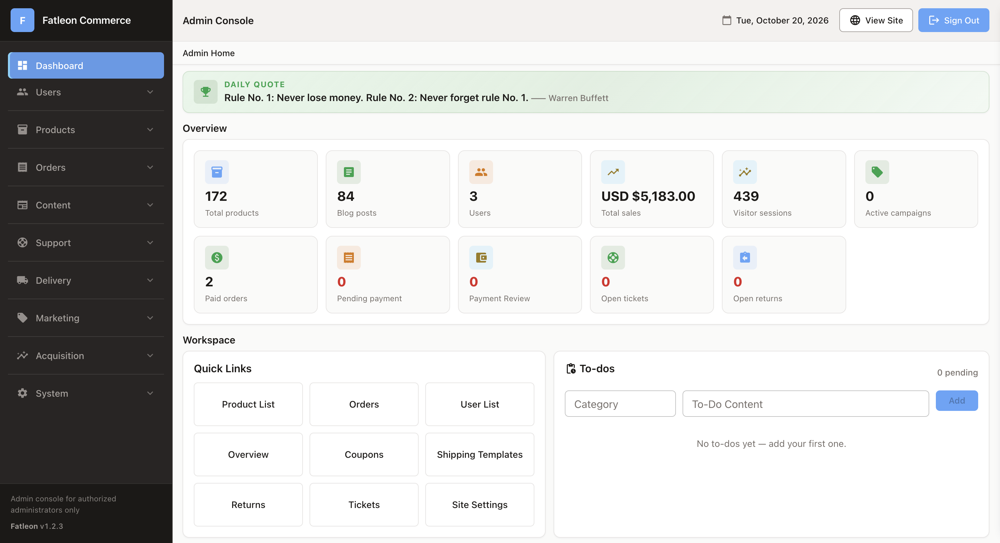

# FatLeon Features

FatLeon is self-hosted e-commerce software that brings the core components of an online store together in one codebase. It includes the storefront, checkout, order management, admin tools, customer accounts, promotions, analytics, and integrations to help you build and operate your store.

Deploy FatLeon to your own AWS environment and customize the code to fit your business needs.

This page provides an overview of the features included. Visit the [live demo](https://live.fatleon.com/) to explore the storefront and see FatLeon in action.

## Storefront

Build a shopping experience that helps customers discover products and move from browsing to checkout.

- **Product discovery:** Product listings, product detail pages, search, brands, and categories.
- **Shopping tools:** Shopping cart and wishlist.
- **Responsive layouts:** Interfaces designed for desktop, tablet, and mobile screens.

## Checkout and Order Management

Support different purchasing scenarios and manage orders from a centralized admin interface.

- **Flexible checkout:** Checkout for registered customers and guest shoppers.
- **Customer order tracking:** Customers can view and track their own orders.
- **Order administration:** Manage orders through the admin interface.
- **Order status notifications:** Email customers when an order's status changes, once you connect an email provider.
- **Flexible fulfillment:** Support multiple delivery addresses, store pickup, and splitting an order across multiple fulfillments.
- **Multiple product types:** Support physical goods, digital goods, and affiliate products or outbound purchase links.
- **Configurable shipping charges:** Charge a flat shipping rate or a rate per item.
- **Single-store currency:** Use one configured currency for displayed prices and checkout.

## Admin and Content Management

Manage your store's products, content, and configuration from one place.

- **Product catalog:** Manage products, brands, and inventory.
- **Content management:** Create and manage posts and other site content.
- **Site configuration:** Manage site settings and assets.
- **Analytics overview:** Review key store analytics in the admin interface.

## Localization and SEO

Prepare your store for customers using different languages and make your pages easier for search engines to understand.

- **Seven languages:** Support seven languages, with language detection based on the visitor's device language.
- **Language switching:** Let visitors switch languages using a language selector.
- **Localized URLs:** Use a language prefix in each URL.
- **Page-level SEO settings:** Configure SEO fields for individual pages.

## Customer Accounts, Referrals, and Support

Provide customer-facing features beyond the standard shopping and checkout experience.

- **Customer accounts:** Give customers a dedicated account area.
- **Referral and commission tracking:** Track referrals and associated commissions.
- **Support tickets:** Provide a ticket-based channel for customer support.
- **Visitor activity analytics:** Track visitor activity, including cart and wishlist interactions.

## Promotions and Discounts

Create offers for individual products or for the store as a whole.

- **Single-item discounts:** Apply a discount to an individual item.
- **Tiered site-wide promotions:** Configure site-wide promotions with tiered discounts.
- **Targeted coupons:** Offer coupons in addition to item discounts and site-wide promotions.

## Built-in Integrations

FatLeon includes integrations that can be enabled and configured through the admin interface. These are part of the product's codebase, rather than features that require browsing a separate third-party plugin directory.

- **Payment providers:** Stripe and PayPal.
- **Web analytics:** Google Analytics 4 (GA4).
- **Social sign-in:** Sign in with a Google account.
- **Live chat:** Crisp or Tawk.

### Email Provider

Order notifications and customer account emails require an email provider that you choose and configure. FatLeon does not restrict these email workflows to a single vendor.

## Explore FatLeon

The best way to understand the shopping experience is to try the live demo.

- **[Explore the live demo](https://live.fatleon.com/)**
- **[Visit the FatLeon website](https://fatleon.com/)**

FatLeon gives you an integrated e-commerce foundation that you can deploy in your own AWS environment and adapt to your business—without making your store dependent on a large third-party plugin ecosystem.
